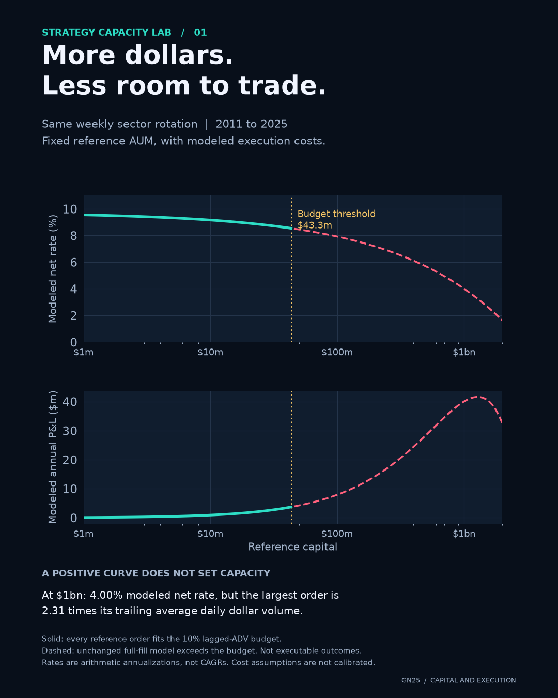

# Strategy Capacity Lab

How much capital can the same strategy take before its trades exceed a liquidity budget?

This study keeps one historical exposure path fixed, varies reference capital, and measures modeled execution costs alongside order size relative to lagged dollar volume. A positive modeled P&L is insufficient to establish executable capacity.



## Results

Daily observations from 3 January 2011 through 31 December 2025, with 2010 used for warm-up. Base assumptions: 5 bps one-way linear costs, impact coefficient 0.5, and a 10% participation budget for each asset/day order.

| Constant reference capital | Modeled net annual rate | Modeled annual dollar P&L | Largest order / lagged dollar ADV | Every order within budget? |
|---|---:|---:|---:|---|
| $1 million | 9.55% | $95,451 | 0.23% | Yes |
| $10 million | 9.15% | $915,363 | 2.31% | Yes |
| $100 million | 7.92% | $7,915,795 | 23.10% | No |
| $1 billion | 4.00% | $40,014,241 | 230.98% | No |

The largest reference capital fitting **every** order within 10% of lagged dollar ADV is **$43,293,764**. The binding order is XLB on 15 June 2015: 33.24% of portfolio value against trailing 20-session dollar ADV of $143.9 million. Budgets of 5% and 20% give $21.6 million and $86.6 million respectively.

These are thresholds under chosen planning rules. They are not measured current ETF capacity or an allocation recommendation. Full-fill curves above the budget are explicitly infeasible extrapolations of the unchanged strategy.

## Fixed strategy and chronology

- Universe: the original nine sector SPDR ETFs, XLB, XLE, XLF, XLI, XLK, XLP, XLU, XLV and XLY. All predate evaluation; newer sector funds are excluded. This is a deliberately fixed historical universe, not a claim of exhaustive or unbiased strategy selection.
- Rank trailing 126-session adjusted-close returns ending 21 sessions before the weekly signal close. Select the top three with positive momentum, allocating one third to each; unused slots are zero-return cash.
- Form signals at the last trading close of the calendar week. Apply new weights at the next available session's closing reference price. Existing holdings earn that session's return before rebalancing. Start in cash and charge the first entry.
- Rebalance the same reference exposure path at every capital level. The historical signal parameters were fixed before downloading the data for this experiment; no signal or cost parameter is optimized to improve these results.
- Lag both 20-session dollar ADV and daily return volatility one session. Never use execution-day volume as an input.

`config/protocol.json` specifies the protocol. `results/protocol_lock.json` records its hash and lock time. It is a local experiment lock, not an external preregistration.

## Cost and capacity definitions

For an asset order with absolute portfolio weight change `dw`, constant reference capital `A`, lagged daily volatility `sigma`, and lagged dollar ADV `V`:

```text
order dollars       = A * dw
participation       = A * dw / V
linear return cost  = dw * 0.0005
impact return cost  = dw * eta * sigma * sqrt(A * dw / V)
daily net return    = reference gross return - sum(linear + impact costs)
annual net rate     = 252 * mean(daily net return)
annual dollar P&L   = A * annual net rate
budget threshold    = min over nonzero orders of (budget * V / dw)
```

Impact coefficients 0.25, 0.5 and 1.0 are **assumptions for sensitivity**, not calibrated estimates or confidence intervals. The square-root form is inspired by institutional impact literature, which also documents different impact regimes. It does not establish an ETF-specific coefficient or validate this approximation at extreme participation.

The threshold tests the worst order over the entire sample. It is conservative relative to a policy permitting occasional exceptions. It does not simulate delayed execution, auction access, order splitting, constrained holdings or changed signals. Orders are never silently clipped.

Capital is held fixed for cost estimation. Rates are arithmetic annualizations, **not CAGRs**, and dollar P&L is a constant-reference-capital estimate, **not a compounded wealth simulation**. Gross annual rate is 10.55%, annual one-way turnover 16.52x, and the linear cost deduction 0.83 percentage points. No claim of alpha versus a benchmark is made.

## Reproduce

Python 3.11+; developed with Python 3.12.13 on macOS ARM.

```bash
uv venv --python 3.12
uv pip install --python .venv/bin/python -r requirements-lock.txt
uv pip install --python .venv/bin/python --no-deps -e .
.venv/bin/python -m strategy_capacity.study fetch
.venv/bin/python -m strategy_capacity.study run
.venv/bin/python -m strategy_capacity.study plot
.venv/bin/python -m pytest -q
```

`fetch` downloads daily Yahoo Finance chart responses for nine symbols. Raw responses are excluded from Git; the source manifest records URLs, query parameters and SHA-256 hashes. Revised upstream history can produce a different snapshot. Keep the original raw files to reproduce the exact snapshot. Outputs include the full capital grid, daily reference returns, order and portfolio weights, lagged inputs, sensitivity summaries, three portrait PNGs, and a GIF/MP4 animation.

Tests cover signal timing, exclusion of recent and future returns, cash slots, lagged liquidity inputs, square-root cost scaling, zero trades, the exact binding capacity constraint, and execution timing. The public outputs make the headline calculations independently checkable.

## Sources and limits

- [Yahoo Finance](https://finance.yahoo.com/): historical daily adjusted closes, closes and volumes, fetched through its chart endpoint. Historical adjusted prices are reconstructed today, not point-in-time archived data. No redistribution of raw source responses is included.
- [State Street sector ETF reference, December 2019](https://www.ssga.com/library-content/pdfs/etf/us/target-a-lower-cost-of-ownership-with-sector-etfs.pdf): inception dates of the original nine sector funds and later additions.
- [Bucci, Benzaquen, Lillo and Bouchaud, *Crossover from linear to square-root market impact*](https://arxiv.org/abs/1811.05230): empirical background for impact scaling, not calibration of this experiment.

Daily ETF share volume is an incomplete liquidity proxy. Underlying basket liquidity, creation/redemption, intraday conditions, execution duration and routing can change what is actually executable. Fees and impact are hypothetical. Cash interest, funding, taxes, market changes and future signal decay are excluded. This is a capacity sensitivity experiment on historical reference marks, not verified trading performance.
